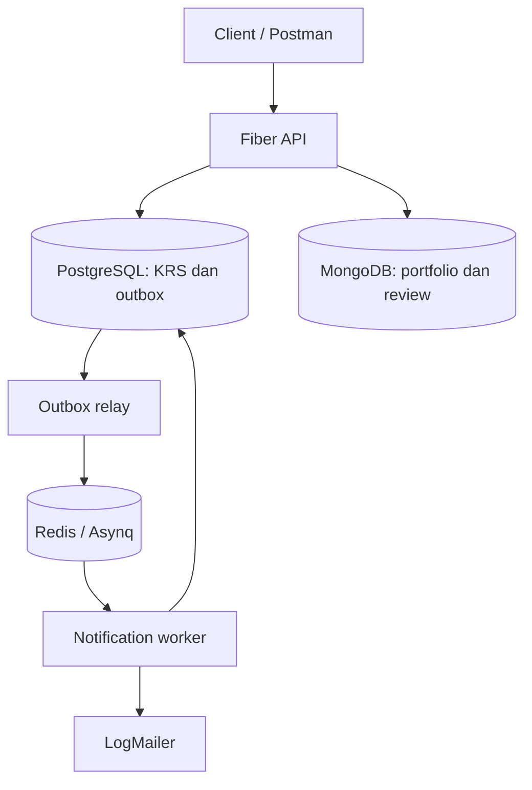

# Arsitektur Background Job

API Fiber menangani perubahan KRS, lalu menyimpan event pada tabel outbox dalam transaksi PostgreSQL yang sama. Relay membaca event yang belum dipublikasikan dan mengantrekannya melalui Redis/Asynq. Worker memproses task, mencatat notifikasi, serta menggunakan LogMailer sebagai simulasi pengiriman email.

## Alur satu perubahan KRS

1. API memvalidasi pengguna, kelas, dan kuota.
2. Perubahan enrollment dan event outbox disimpan secara atomik.
3. Relay menerbitkan task; event baru ditandai `published` setelah enqueue berhasil.
4. Worker menangani task berdasarkan tipe event dan identitas outbox.
5. Constraint notifikasi membantu mencegah duplikasi ketika task diproses ulang.

Perubahan KRS tetap dapat diterima ketika Redis sementara tidak tersedia. Event menunggu dalam PostgreSQL hingga relay berhasil meneruskannya.

## Komponen penting

| Komponen | File utama |
| --- | --- |
| Transaksi KRS | `app/service/course_service.go` |
| Repository outbox | `app/repository/outbox_repository.go` |
| Relay | `app/service/outbox_relay.go` |
| Worker notifikasi | `app/service/notification_worker.go` |
| Mailer simulasi | `helper/mailer.go` |
| Konfigurasi queue | `config/queue.go` |
| Entrypoint dan shutdown | `main.go`, `worker.go` |

Aplikasi mendukung `-role=api`, `-role=worker`, dan `-role=all`. Untuk menghentikan proses, aplikasi menangani sinyal interrupt dan melakukan penghentian komponen secara bertahap.

## Batas implementasi

- LogMailer merupakan simulasi; hasilnya tidak membuktikan email diterima oleh layanan eksternal.
- Pemrosesan antrean menggunakan pola *at-least-once*, sehingga idempotensi diperlukan.
- Pengiriman email ke sistem luar tidak dapat dijamin *exactly-once* hanya dengan transaksi database.
- Varian D.2 memakai build tag `d2` dan migration 009 pada lingkungan terpisah. Uji runtime multi-penerima belum lengkap.

Hasil pengujian dan batas pembuktiannya dirangkum pada [README utama](../README.md).
