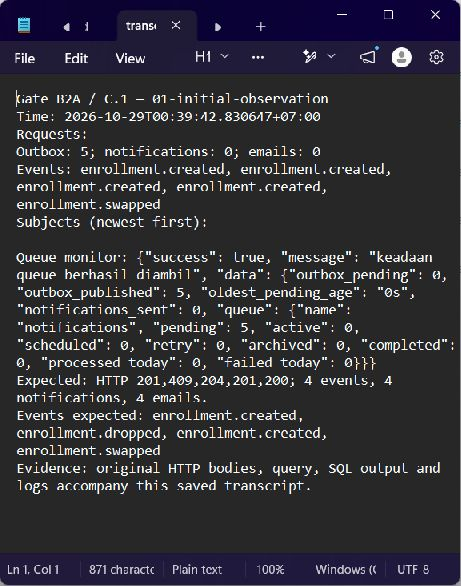
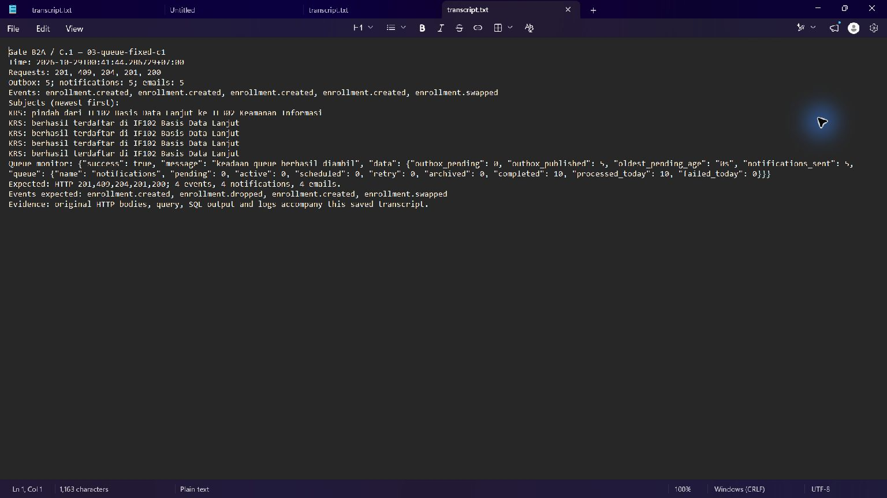
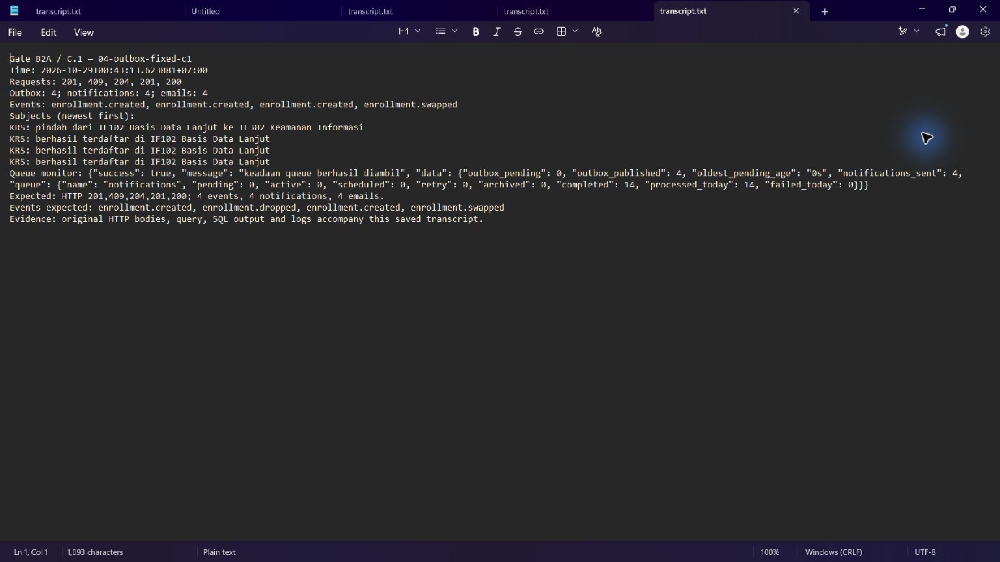
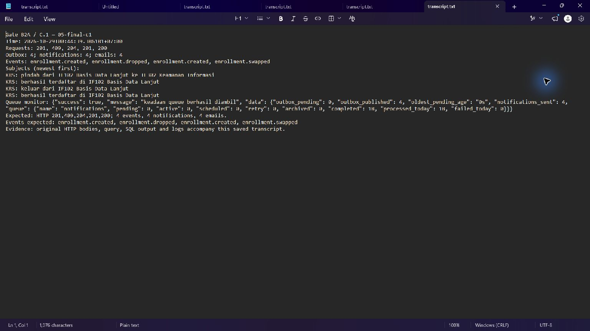

# D.1 — Berita acara perbaikan Gate B2A

Tanggal evidence: 29 Oktober 2026 (WIB). Modul: `pertemuan-11-background-job`.

Dokumen ini melengkapi bahan D.1 dengan tiga kesalahan perilaku yang dibuktikan melalui C.1 pada Gate B2A. Acuan penerimaan adalah *Modul 11 — Background Job*, C.1 hlm. 32 dan D.1 hlm. 34, sebagaimana dipetakan pada [checklist Gate B2](../../docs/GATE_B2_CHECKLIST.md). Hasil Gate B1 yang telah diterima tetap berlaku dan tidak diulang; bukti P11-01–P11-03 tersedia pada [bahan D.1 Gate B1](../gate-b1/compiler-2026-10-27/D1-w11.md). P11-06–P11-08, C.2–C.8 secara keseluruhan, D.2, dan D.3 tetap PENDING. Keberhasilan C.1 di sini tidak membuktikan skenario kegagalan, retry, maupun idempotency.

## Asal dan keterbatasan bukti

Evidence tiap tahap memuat `result.json`, `query.sql`, `sql-output.txt`, `transcript.txt`, serta salinan source pada saat observasi. Screenshot merupakan tangkapan autentik Notepad yang menampilkan transcript hasil tersimpan, **bukan terminal live**. Angka pada transcript perlu dibaca bersama JSON respons dan hasil SQL; label `Expected` merupakan kriteria, bukan hasil aktual.

Pada tahap `01-initial-observation`, collector JSON gagal menyimpan daftar request. Oleh karena itu kolom `Requests` kosong dan status HTTP awal tidak diklaim terbukti dari tahap tersebut. Keadaan awal dipulihkan dari hasil SQL dan observasi yang tersedia: lima row outbox telah published, lima task masih pending, belum ada notifikasi atau email. Pengulangan C.1 pada tahap `03-queue-fixed-c1` menyimpan kelima request dan respons lengkap. Kekurangan collector pada tahap 01 tidak disamarkan sebagai keberhasilan perekaman HTTP.

## Tabel berita acara

| ID | File/fungsi | Gejala aktual dan uji pengungkap | Akar masalah | Perbaikan dan hasil verifikasi |
|---|---|---|---|---|
| P11-09 | `config/queue.go`, `NewWorkerServer` | C.1 awal: outbox published 5, queue `notifications` pending 5, notifikasi 0, email 0. Setelah koreksi queue, backlog yang sama selesai: pending 0, completed 5, notifikasi 5, email 5. | Worker menggunakan `model.TaskSendNotification` sebagai nama queue, sedangkan relay mengirim ke `model.QueueNotifications`. Nama jenis task berbeda perannya dengan nama queue. | Ubah key `Queues` menjadi `model.QueueNotifications`. Bukti tahap 01 → 02 menunjukkan task kemudian diproses. Jumlah 5 belum memenuhi C.1; kesalahan producer dan event Drop masih terlihat. |
| P11-04 | `app/service/course_service.go`, `Enroll` | C.1 tahap 03 menghasilkan HTTP 201, 409, 204, 201, 200, tetapi outbox/notifikasi/email masing-masing 5. Setelah koreksi, tahap 04 menghasilkan status sama dengan hitungan masing-masing 4. | `s.outbox.Insert(...)` memakai repository pool meskipun dipanggil di dalam callback transaksi KRS. Event yang ditulis sebelum `InsertEnrollment` gagal karena duplikasi tidak ikut rollback. | Gunakan `s.outbox.WithTx(tx).Insert(...)`. Tahap 05 menguatkan pembuktian: jumlah outbox sesudah request pertama 1 dan tetap 1 setelah request kedua ditolak dengan `ALREADY_ENROLLED`. Event untuk request gagal tidak tertinggal. |
| P11-05 | `app/service/course_service.go`, `Drop` | Setelah P11-04 diperbaiki, tahap 04 sudah memiliki empat event, tetapi urutannya `created, created, created, swapped`; tindakan DELETE tetap menghasilkan subjek pendaftaran. | Cabang Drop memakai `model.EventEnrollmentCreated`, sehingga worker membentuk isi notifikasi berdasarkan jenis event yang salah. | Ganti dengan `model.EventEnrollmentDropped`. Tahap 05 menghasilkan `created, dropped, created, swapped` dan subjek keluar kelas pada notifikasi terkait. Keempat event, notifikasi, dan email tetap berjumlah 4. |

## P11-09 — Pemulihan pemrosesan queue

**Gambar B2A.1. Observasi awal C.1 pada transcript tersimpan.** Queue `notifications` menampung lima task pending, sementara jumlah notifikasi dan email masih nol. Daftar request pada tahap ini tidak tersimpan akibat kegagalan collector.

Bukti source awal menunjukkan `Queues: map[string]int{model.TaskSendNotification: 1}`. Pada [snapshot setelah koreksi](02-queue-fixed-drained/config__queue.go.txt), worker mendengarkan `model.QueueNotifications`. [Hasil tahap 02](02-queue-fixed-drained/result.json) dan [transcript tahap 02](02-queue-fixed-drained/transcript.txt) mencatat pending turun dari 5 ke 0, completed menjadi 5, serta notifikasi dan email bertambah dari 0 ke 5. Perbandingan ini membuktikan bahwa backlog sudah mencapai worker setelah nama queue diselaraskan. Hasil tersebut sekaligus membuka gejala berikutnya: jumlah dan jenis event masih salah.

## P11-04 — Atomicity enrollment dan outbox

**Gambar B2A.2. C.1 setelah queue diperbaiki, sebelum koreksi transaksi outbox.** Kelima respons HTTP telah tersimpan; respons pendaftaran duplikat adalah 409, tetapi terdapat lima event dan lima notifikasi/email.

[Respons dan hasil SQL tahap 03](03-queue-fixed-c1/result.json) memperlihatkan lima event untuk rangkaian yang seharusnya menghasilkan empat perubahan KRS. [Snapshot source sebelum koreksi](03-queue-fixed-c1/app__service__course_service.go.txt) menunjukkan insert event melalui pool sebelum `InsertEnrollment`. Ketika pendaftaran duplikat ditolak, transaksi KRS dibatalkan, tetapi insert event pada koneksi pool telah berdiri sendiri. Inilah sebabnya penolakan HTTP saja belum cukup membuktikan atomicity.

**Gambar B2A.3. C.1 setelah insert outbox diikat pada transaksi KRS.** Status HTTP tetap sesuai kontrak dan hitungan menjadi empat event, empat notifikasi, serta empat email. Jenis event Drop masih salah pada tahap ini.

[Hasil tahap 04](04-outbox-fixed-c1/result.json) memperlihatkan pengurangan dari lima menjadi empat row setelah penggunaan `WithTx(tx)`. Bukti final juga merekam hitungan outbox setelah setiap request: `1, 1, 2, 3, 4`. Dengan demikian request kedua yang berstatus 409 tidak menambah row. ID outbox yang memiliki celah tidak digunakan sebagai hitungan event; hasil query aktual menjadi dasar penilaian.

## P11-05 — Ketepatan event keluar kelas

Tahap 04 sudah memenuhi hitungan C.1, tetapi event kedua masih `enrollment.created`. Akibatnya daftar notifikasi menampilkan tiga subjek pendaftaran dan satu subjek pindah kelas. Hal ini membuktikan bahwa pemeriksaan jumlah saja dapat meloloskan notifikasi yang salah makna. [Snapshot tahap 04](04-outbox-fixed-c1/app__service__course_service.go.txt) mengaitkan gejala tersebut dengan konstanta `EventEnrollmentCreated` pada fungsi Drop.

Setelah koreksi ke `EventEnrollmentDropped`, [hasil final tahap 05](05-final-c1/result.json) dan [hasil SQL final](05-final-c1/sql-output.txt) mencatat empat event: `enrollment.created`, `enrollment.dropped`, `enrollment.created`, `enrollment.swapped`. Notifikasi untuk event keluar kelas memakai subjek `KRS: keluar dari IF102 Basis Data Lanjut`. Perubahan jenis event memperbaiki isi notifikasi tanpa mengubah jumlahnya.

**Gambar B2A.4. C.1 final setelah tiga koreksi perilaku.** Tangkapan Notepad atas transcript aktual memperlihatkan status kelima request, empat event dengan jenis yang benar, empat notifikasi/email, dan urutan subjek. Hasil terstruktur tersedia pada JSON dan SQL tahap yang sama.

## Hasil C.1 final

| Urutan | Request (path relatif API) | Respons aktual | Jumlah outbox setelah request |
|---|---|---|---|
| 1 | `POST /courses/2/enroll` | 201 | 1 |
| 2 | `POST /courses/2/enroll` ulang | 409, `ALREADY_ENROLLED` | 1 |
| 3 | `DELETE /courses/2/enroll` | 204 | 2 |
| 4 | `POST /courses/2/enroll` | 201 | 3 |
| 5 | `POST /enrollments/swap`, kelas 2 → 4 | 200 | 4 |

Respons `/notifications/mine` final berstatus 200 dan memuat tepat empat notifikasi dengan urutan newest-first berikut:

1. `KRS: pindah dari IF102 Basis Data Lanjut ke IF302 Keamanan Informasi`.
2. `KRS: berhasil terdaftar di IF102 Basis Data Lanjut`.
3. `KRS: keluar dari IF102 Basis Data Lanjut`.
4. `KRS: berhasil terdaftar di IF102 Basis Data Lanjut`.

Hitungan row outbox, row notifikasi, dan baris email terfilter untuk akun uji masing-masing 4. Monitor final menunjukkan outbox pending 0, outbox published 4, serta queue pending/active/retry/archived 0. Nilai `completed: 18` dan `processed_today: 18` adalah statistik kumulatif queue selama rangkaian observasi, bukan jumlah email pada satu uji C.1. Untuk C.1 digunakan hitungan terfilter akun dan hasil query tahap final.

Bukti terstruktur final dan screenshot tahap 05 tersedia; hasil aktual memenuhi kontrak C.1 untuk respons, jumlah, jenis event, serta urutan subjek. D.1 keseluruhan belum lengkap karena tiga kandidat runtime P11-06–P11-08 masih menunggu tahap pengujian yang sesuai. Tidak ada build, vet, HTTP/API, server/worker, operasi database, atau pengujian yang dijalankan oleh penulis dokumen ini; penulisan hanya membaca evidence dan snapshot source yang sudah tersedia.

